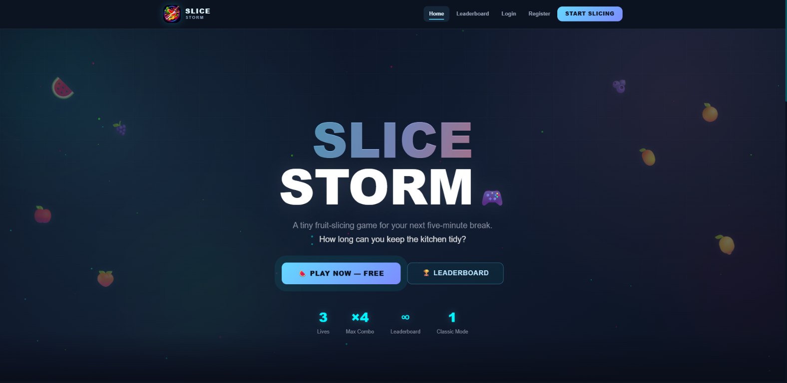
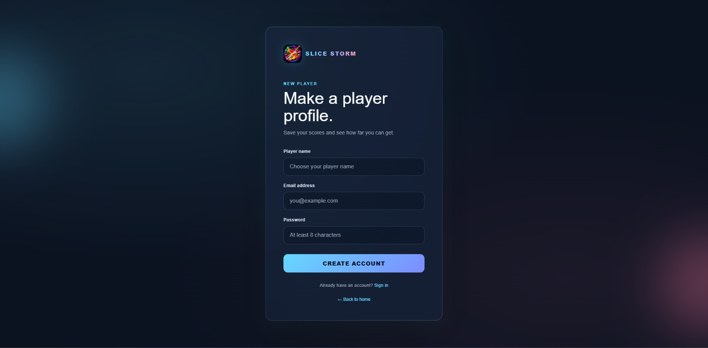
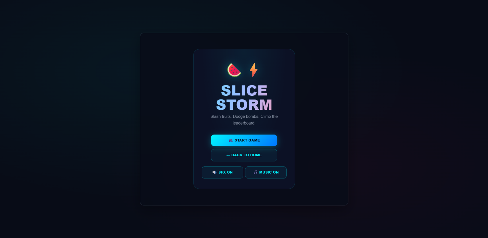
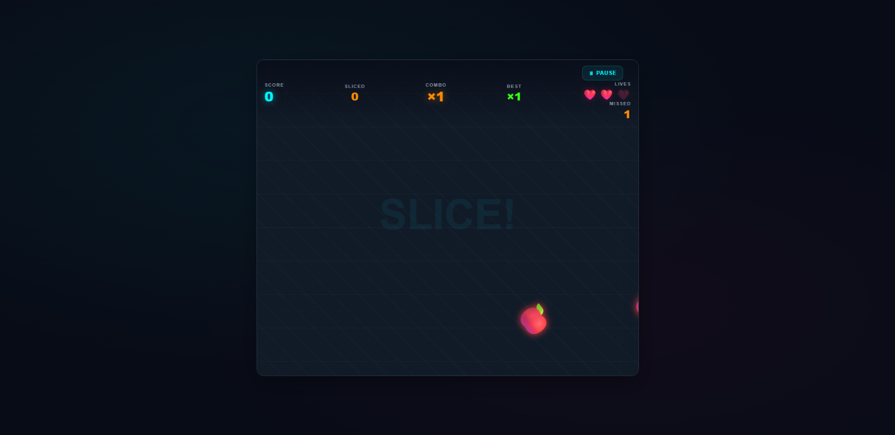
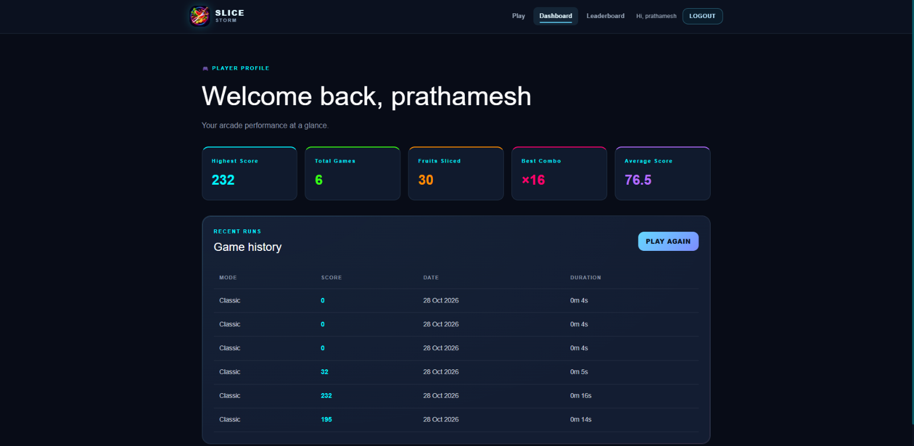
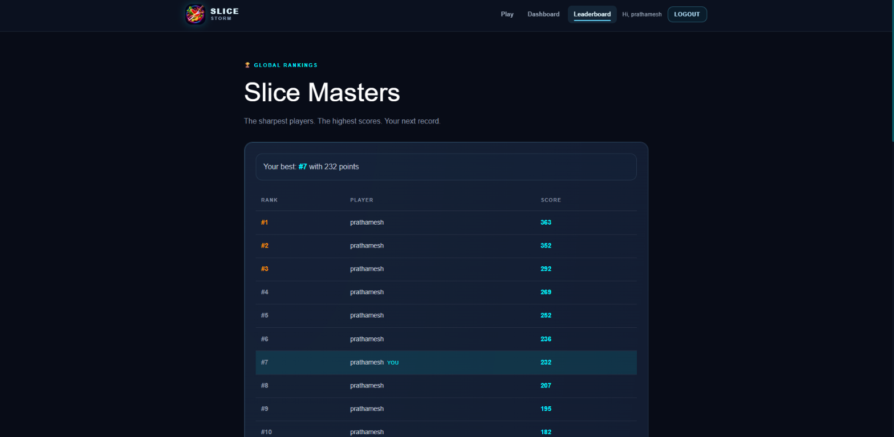

<div align="center">


# SLICE STORM

### A fast-paced fruit-slicing arcade game built for quick breaks and high scores.

Slice fruit. Dodge bombs. Build combos. Climb the leaderboard.

<p>
  <a href="https://slice-storm-project-1.onrender.com/api/health">
    
  </a>
  
  
  
  
</p>

</div>

---

## Contents

- [Project overview](#project-overview)
- [Highlights](#highlights)
- [Technology](#technology)
- [Live deployment](#live-deployment)
- [Screenshots](#screenshots)
- [Run locally](#run-locally)
- [Environment variables](#environment-variables)
- [How the game works](#how-the-game-works)
- [API reference](#api-reference)
- [Data models](#data-models)
- [Project structure](#project-structure)
- [Demo checklist](#demo-checklist)
- [Known limitations](#known-limitations)
- [Validation](#validation)

## Project overview

**Slice Storm** is a responsive full-stack arcade game where players create a
profile, play a Classic fruit-slicing run, save their score, and compete with
other players.

The project combines a polished Next.js game interface with an Express API,
MongoDB persistence, and cookie-based authentication. The game is playable with
mouse or touch input and is designed to work on desktop and mobile layouts.

## Highlights

### Arcade gameplay

- HTML Canvas gameplay with mouse and touch/pointer controls.
- Seven fruit types with different point values.
- Three lives per run.
- Bombs and missed fruit reduce lives.
- Increasing spawn rate, speed, fruit count, and bomb probability.
- Multi-slice bonuses and combo milestone feedback.
- Sound effects and music toggles.

### Full-stack features

- Account registration, login, logout, and current-user session handling.
- HTTP-only JWT authentication cookie.
- Authenticated game sessions owned by the player who started them.
- Personal dashboard with score statistics and recent game history.
- Public leaderboard with pagination.
- Personal leaderboard rank for authenticated players.

### Backend quality

- MongoDB persistence through Mongoose.
- Request validation with Zod.
- Password hashing with bcryptjs.
- Helmet security headers.
- Credential-aware CORS.
- Global and authentication-specific rate limiting.
- Basic server-side game-result integrity checks.

## Technology

| Area | Stack |
| --- | --- |
| Frontend | Next.js 16, React 19, JavaScript, CSS, HTML Canvas |
| Backend | Node.js 20+, Express 5, ES modules |
| Database | MongoDB, Mongoose 8 |
| Authentication | JWT, HTTP-only cookies, bcryptjs |
| Validation | Zod |
| Security | Helmet, CORS, express-rate-limit |
| Deployment | Render configuration included in `render.yaml` |

## Live deployment

| Service | URL | Status |
| --- | --- | --- |
| Backend API | [slice-storm-project-1.onrender.com](https://slice-storm-project-1.onrender.com) | Live |
| Health check | [`/api/health`](https://slice-storm-project-1.onrender.com/api/health) | API + database status |
| Frontend | Not configured in this repository | Run locally on port `3000` |

The health endpoint should return `ok: true` when the API and MongoDB connection
are available. A public frontend URL should be added here when the frontend is
deployed separately.

## Screenshots

These final application captures were supplied from the real Slice Storm
interface. Each image is stored inside the repository so it renders directly
on GitHub and in Markdown preview.

### Landing page



### Player registration



### Play menu



### Live gameplay



### Dashboard



### Leaderboard



## Run locally

### Prerequisites

- Node.js 20 or newer
- npm
- MongoDB Atlas or a local MongoDB instance

### 1. Clone the repository

```powershell
git clone https://github.com/prathameshpimpale07-byte/Slice-Storm-Project.git
cd "Slice-Storm-Project"
```

### 2. Configure and run the backend

```powershell
cd backend
npm install
```

Create `backend/.env` using the template below:

```dotenv
PORT=5000
MONGODB_URI=<your MongoDB connection string>
JWT_SECRET=<a random secret with at least 32 characters>
FRONTEND_URL=http://localhost:3000
NODE_ENV=development
```

Start the API:

```powershell
npm run dev
```

The backend runs at [http://localhost:5000](http://localhost:5000).

### 3. Configure and run the frontend

Open a second terminal:

```powershell
cd frontend
npm install
```

Create `frontend/.env.local`:

```dotenv
NEXT_PUBLIC_API_URL=http://localhost:5000
```

Start Next.js:

```powershell
npm run dev
```

Open [http://localhost:3000](http://localhost:3000).

### Production frontend build

```powershell
cd frontend
npm run build
npm start
```

## Environment variables

Only variable names and safe placeholders belong in documentation. Never commit
real database credentials, JWT secrets, cookies, or production environment
files.

| Variable | Service | Required | Description |
| --- | --- | --- | --- |
| `PORT` | Backend | No | HTTP port; defaults to `5000` locally |
| `MONGODB_URI` | Backend | Yes | MongoDB connection string |
| `JWT_SECRET` | Backend | Yes | JWT signing secret; minimum 32 characters |
| `FRONTEND_URL` | Backend | No | Allowed frontend origin for credentialed CORS |
| `NODE_ENV` | Backend | No | `development`, `test`, or `production` |
| `NEXT_PUBLIC_API_URL` | Frontend | No | Backend base URL |

The backend validates its environment on startup. A missing MongoDB URI or
invalid JWT secret prevents the service from starting, which makes deployment
configuration errors visible instead of silently falling back.

## How the game works

### Gameplay rules

1. A Classic run starts with **three lives**.
2. Drag through fruit with a mouse or swipe across it on a touch device.
3. Missing fruit costs one life.
4. Hitting a bomb costs one life.
5. The run ends when all lives are lost.
6. Completed results are saved to the authenticated player's history.
7. Difficulty increases as the run progresses.

### Fruit scoring

| Fruit | Points |
| --- | ---: |
| Apple | 10 |
| Orange | 12 |
| Kiwi | 14 |
| Banana | 15 |
| Strawberry | 18 |
| Watermelon | 20 |
| Pineapple | 25 |

### Combo and multi-slice scoring

- Every fruit contributes its base point value.
- A multi-slice adds `5 × (number of fruits - 1)` bonus points.
- Combo milestone feedback appears at ×3, ×5, and ×10.
- The game UI supports a maximum displayed combo multiplier of ×4.

Example: slicing three fruits worth 10, 12, and 15 points gives
`10 + 12 + 15 + (2 × 5) = 47` points.

## API reference

All endpoints return JSON. Registering or logging in creates an HTTP-only
authentication cookie and returns an access token for browsers that
block cross-site cookies (common on some mobile browsers). The frontend stores
that token locally and sends it as a Bearer token when needed. Browser requests
also use credentials, and protected routes return `401 Unauthorized` when both
authentication methods are missing or invalid.

### Health

| Method | Endpoint | Auth | Purpose |
| --- | --- | --- | --- |
| `GET` | `/api/health` | Public | Reports API and MongoDB connection state |

### Authentication

| Method | Endpoint | Auth | Request |
| --- | --- | --- | --- |
| `POST` | `/api/auth/register` | Public | `{ name, email, password }` |
| `POST` | `/api/auth/login` | Public | `{ email, password }` |
| `POST` | `/api/auth/logout` | Public | No body; clears the cookie |
| `GET` | `/api/auth/me` | Optional | Returns the current user or `user: null` |

Registration passwords must contain 8–128 characters. Authentication attempts
are rate-limited to 20 requests per 15 minutes.

### Games

| Method | Endpoint | Auth | Request |
| --- | --- | --- | --- |
| `POST` | `/api/games/start` | Required | `{ "mode": "classic" }` |
| `POST` | `/api/games/complete` | Required | Game result payload |
| `GET` | `/api/games/history` | Required | Optional `?limit=20`, capped at 50 |

The complete-game payload contains:

```json
{
  "sessionId": "server-generated-session-id",
  "score": 250,
  "fruitsSliced": 18,
  "bombsHit": 1,
  "maxCombo": 6,
  "accuracy": 82.5,
  "durationSeconds": 45
}
```

The server verifies session ownership, active status, duration, score range,
fruit rate, bomb rate, and combo range before updating player statistics.

### Leaderboard

| Method | Endpoint | Auth | Request |
| --- | --- | --- | --- |
| `GET` | `/api/leaderboard` | Public | Optional `?page=1&limit=10` |
| `GET` | `/api/leaderboard/me` | Required | No body |

Leaderboard pagination accepts pages from `1` and limits from `1` to `50`.

## Data models

### `User`

| Field | Description |
| --- | --- |
| `name` | Player display name |
| `email` | Unique, normalized email address |
| `passwordHash` | Bcrypt hash; excluded from normal responses |
| `highestScore` | Player's best score |
| `totalGames` | Number of completed games |
| `totalFruitsSliced` | Total fruit sliced across completed games |
| `bestCombo` | Player's best combo |

### `Game`

| Field | Description |
| --- | --- |
| `user` | Owning `User` reference |
| `sessionId` | Unique server-generated game session |
| `mode` | Currently `classic` |
| `score` | Final score |
| `fruitsSliced` | Fruit sliced during the run |
| `bombsHit` | Bombs hit during the run |
| `maxCombo` | Highest combo in the run |
| `accuracy` | Reported accuracy from 0 to 100 |
| `durationSeconds` | Run duration |
| `status` | `active` or `completed` |

## Project structure

```text
.
├── backend/
│   ├── src/
│   │   ├── config/          MongoDB connection
│   │   ├── controllers/     Auth, games, leaderboard
│   │   ├── middleware/      Auth and request middleware
│   │   ├── models/          User and Game schemas
│   │   ├── routes/          API route definitions
│   │   └── services/        Password and JWT helpers
│   ├── GAME-VALIDATION.md   Result-integrity notes
│   └── package.json
├── frontend/
│   ├── public/               Logo and static assets
│   ├── src/
│   │   ├── app/              Pages and layouts
│   │   ├── components/       UI, auth, and game components
│   │   ├── game/             Physics, collision, scoring, audio
│   │   └── lib/              API client
│   ├── .env.example
│   └── package.json
├── docs/screenshots/         Application screenshots
├── render.yaml               Render service configuration
└── README.md
```

## Demo checklist

For the required 2–5 minute demonstration, follow this sequence:

1. Open **SLICE STORM**.
2. Start the game.
3. Slice fruit.
4. Demonstrate a multi-slice.
5. Demonstrate a combo milestone.
6. Hit a bomb.
7. Show game over and the final score.
8. Log in.
9. Show the dashboard.
10. Show the leaderboard.
11. Resize to a mobile viewport or demonstrate responsive behavior on a phone.

The repository includes still-image evidence in
[`docs/screenshots/`](./docs/screenshots/). The binary demo video must be
recorded separately and included in the final submission package.

## Known limitations

- Classic mode is the only available game mode.
- Scores are client-reported and receive range/integrity validation, not
  server-authoritative anti-cheat protection.
- The leaderboard stores completed game entries, so one player may appear in
  multiple rows.
- No public frontend deployment URL is configured in this repository.
- Audio availability depends on browser autoplay and audio-context policies.
- MongoDB is required for login, saved games, dashboard history, and rankings.

## Validation

Run the frontend checks before submission:

```powershell
cd frontend
npm run lint
npm run build
```

Run the backend after configuring `backend/.env`:

```powershell
cd backend
npm start
```

Then verify:

```text
GET http://localhost:5000/api/health
```

---

<div align="center">

Made with fruit, physics, and a little competitive energy.

</div>
